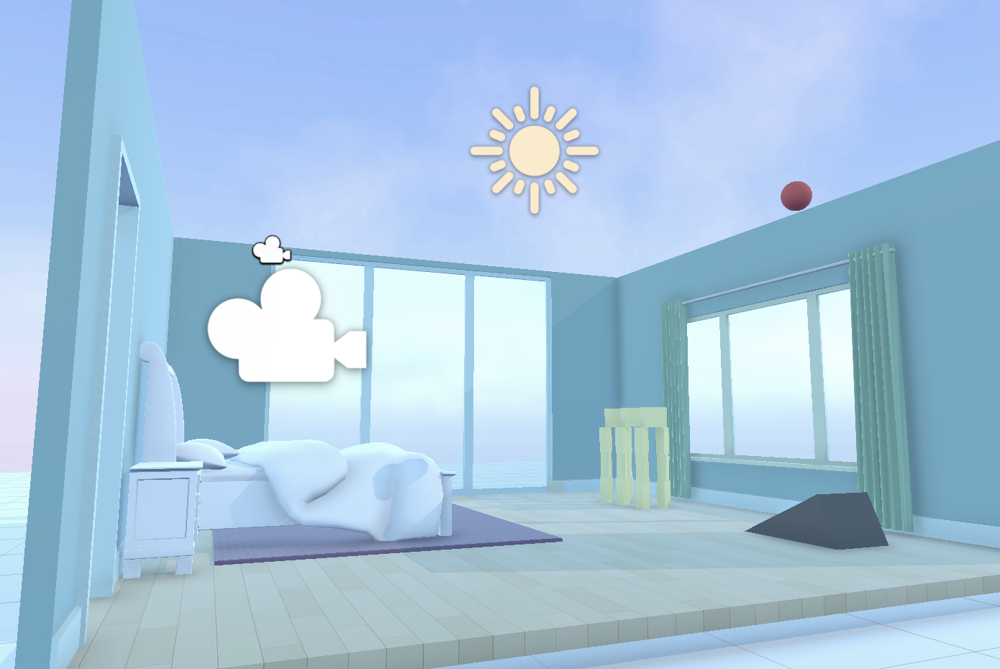
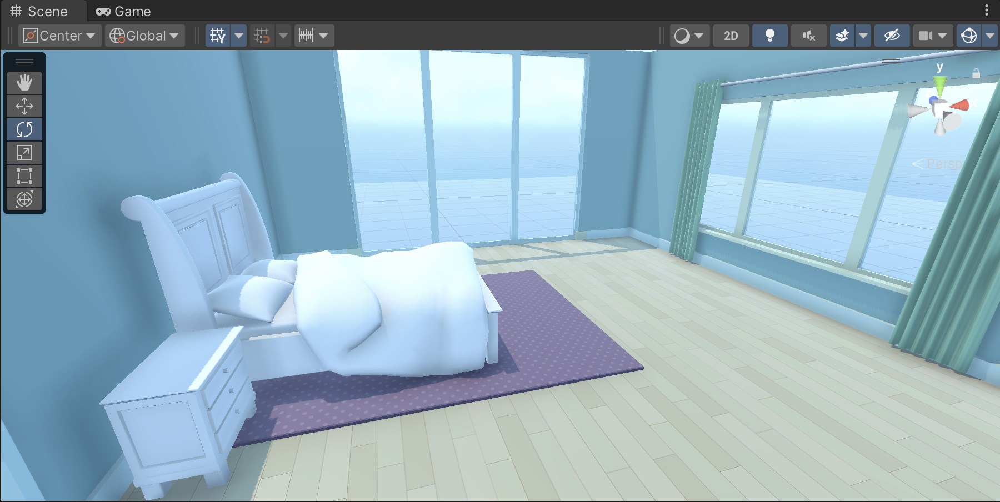
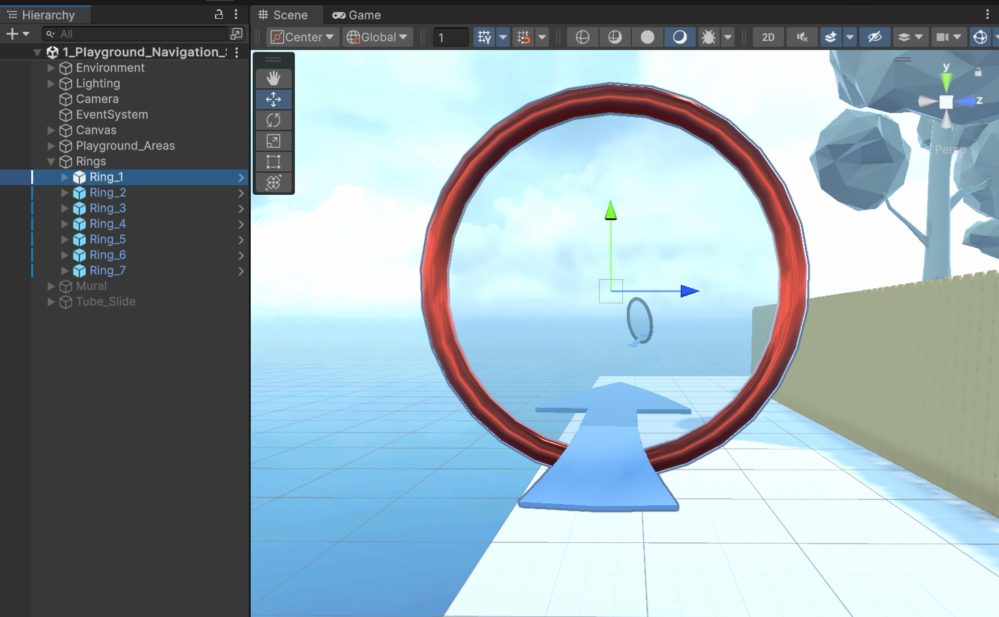
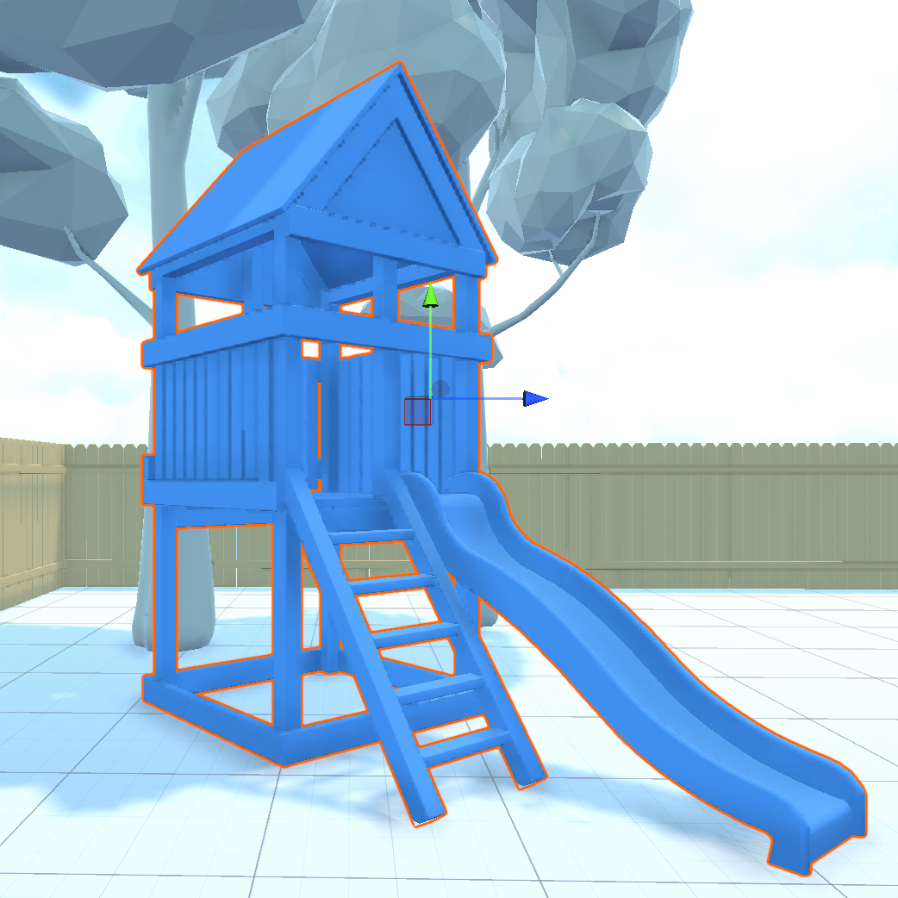

# Assignment: Bounce Ball & 3D Environment
**Student ID:** 62506  
**Name:** M. Usman Ali  
**Class / Section:** CS-51  

---

## Project Overview
This repository contains the Unity 3D assignment demonstrating physics components, Rigidbody, Colliders, Physics Materials, and interactive 3D navigation environments.

## Screenshots from Project Files

### 1. Bounce Ball Scene

### 2. Bedroom Environment Overview

### 3. Playground Navigation Scene

### 4. Playground Playhouse Object

